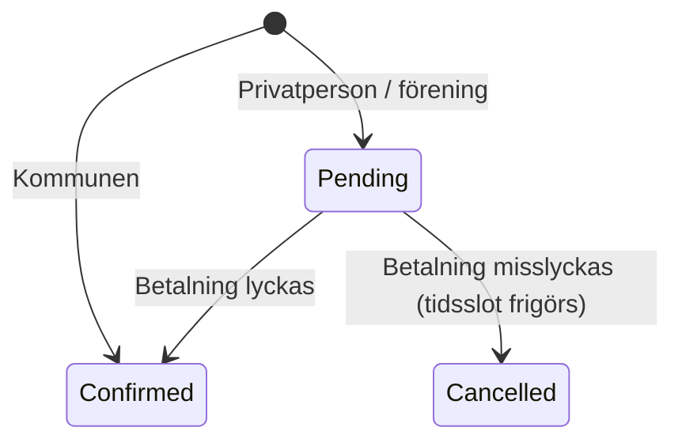

# Domain Storytelling Applied – Kommunal lokalbokning

Ett övningsprojekt i domändriven design (DDD). Utgångspunkten är en domain story om en bokares resa i en kommuns system för att boka lokaler. Repot innehåller bara domänkod och tester, alltså inget UI, inget API och ingen databas.

## Domänen

En **bokare** kan vara en privatperson, en förening eller kommunen själv. Bokaren väljer en **lokal**, till exempel en konferenssal, en slöjdsal eller en fotbollsplan, och en av lokalens fasta **tidsslots**. Bokaren skickar sedan en bokningsförfrågan, och tiden reserveras. Därefter betalar bokaren via en extern betaltjänst, och bokningen bekräftas.

Kommunen betalar inte för sina egna lokaler, så dess bokningar bekräftas direkt.



## DDD-byggstenar

| Begrepp                 | Klass                         | Ansvar                                                                                                                                        |
| ----------------------- | ----------------------------- | --------------------------------------------------------------------------------------------------------------------------------------------- |
| Value object            | `Id`                          | Identitet som inte får vara tom. Skapas med `Id.Generate()`.                                                                                  |
| Value object            | `Timeslot`                    | Start- och sluttid. Invariant: sluttiden måste vara efter starttiden.                                                                         |
| Value object            | `Booker` (+ `BookerType`)     | Vem som bokar: `Private`, `Association` eller `Municipality`.                                                                                 |
| Entity / aggregate root | `Premises`                    | En lokal med fasta tidsslots. Skyddar invarianten att samma slot inte kan dubbelbokas och att bara slots som lokalen erbjuder kan reserveras. |
| Entity / aggregate root | `Booking` (+ `BookingStatus`) | En bokning med livscykeln `Pending` → `Confirmed` / `Cancelled`. Statusen kan bara ändras via `Confirm()` och `Cancel()`.                     |
| Factory                 | `BookingFactory`              | Skapar bokningar. Kommunens bokningar bekräftas direkt.                                                                                       |
| Repository              | `IBookingRepository`          | Sparar och hämtar bokningar. I testerna används `InMemoryBookingRepository`.                                                                  |
| Domain service          | `BookingService`              | Samordnar flöden som berör flera aggregat (`Premises` och `Booking`).                                                                         |
| Extern tjänst           | `IPaymentGateway`             | Betaltjänsten ligger utanför domänen och svarar bara `Success` eller `Failure`. I testerna används `FakePaymentGateway`.                      |

### Flöden i `BookingService`

- **`RequestBooking(booker, premises, timeslot)`** reserverar tidsslotten i lokalen, skapar bokningen via factoryn och sparar den.
- **`PayForBooking(bookingId, premises)`** anropar betaltjänsten med lokalens pris.
  - Om betalningen lyckas bekräftas bokningen.
  - Om den misslyckas avbryts bokningen och tidsslotten frigörs.
  - Bara bokningar med status `Pending` kan betalas. Därför anropas aldrig betaltjänsten för kommunens bokningar.

## Medvetna avgränsningar

För att hålla scopet litet ingår inte:

- timeout för reservationer
- återbetalning
- avbokning av bekräftade bokningar
- godkännande av en handläggare
- persistens
- någon repository för lokaler (lokalen skickas in som parameter)

## Krav

```sh
dotnet --version
```

Versionen ska vara 10 eller högre. Installera annars .NET 10 SDK.

## Kom igång

```sh
git clone https://github.com/emelie-forefront/domain-storytelling-applied.git
cd domain-storytelling-applied
dotnet build
dotnet test
```

## Struktur

```
TE.DomainStorytellingApplied.Domain/        Domänobjekt
  Id.cs, Timeslot.cs, Booker.cs             Value objects
  Premises.cs, Booking.cs                   Entities / aggregate roots
  BookingFactory.cs                         Factory
  IBookingRepository.cs                     Repository-interface
  BookingService.cs                         Domain service
  IPaymentGateway.cs                        Interface mot extern betaltjänst

TE.DomainStorytellingApplied.Domain.Tests/  Tester (xUnit v3 + Shouldly)
  *Tests.cs                                 En testfil per domänklass
  InMemoryBookingRepository.cs              Testimplementation av repository
  FakePaymentGateway.cs                     Fejkad betaltjänst
```

Testerna namnges enligt mönstret `Given…_When…_Should…`.
